# Happy Headlines System

## Architecture

### C4 Diagrams
> Note: In the project description, it's specified that users can also share articles, however no part of the system indicates that anything related to that should be implemented. Therefore, I have left this out of the diagrams.

#### System Context Diagram
<picture>
  <source media="(prefers-color-scheme: dark)" srcset="./docs/figures/revised-context-diagram-dark.png">
  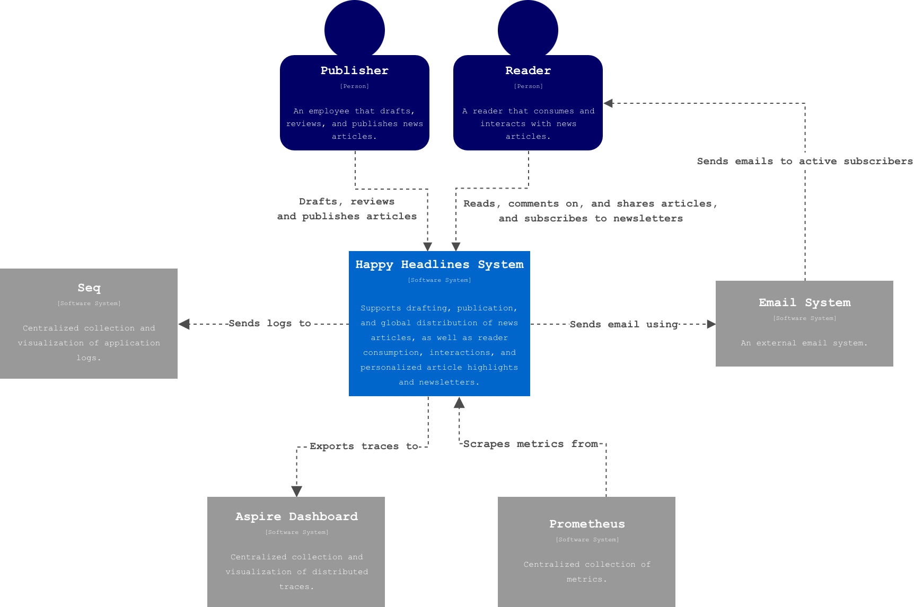
</picture>

<br><br>

#### Container Diagram
<picture>
  <source media="(prefers-color-scheme: dark)" srcset="./docs/figures/revised-container-diagram-dark.png">
  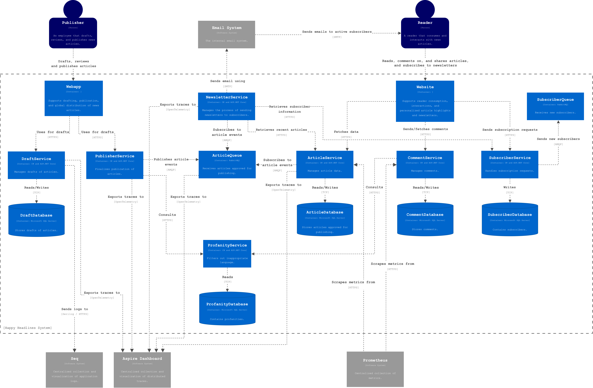
</picture>

### Article Management
Management and storage of published articles.

<picture>
  <source media="(prefers-color-scheme: dark)" srcset="./docs/figures/article-management-container-view-dark.png">
  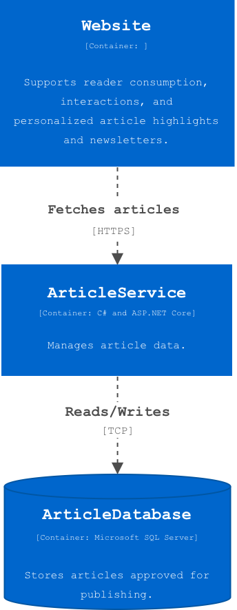
</picture>

##### Scaling
<picture>
  <source media="(prefers-color-scheme: dark)" srcset="./docs/figures/article-architecture-diagram-dark.png">
  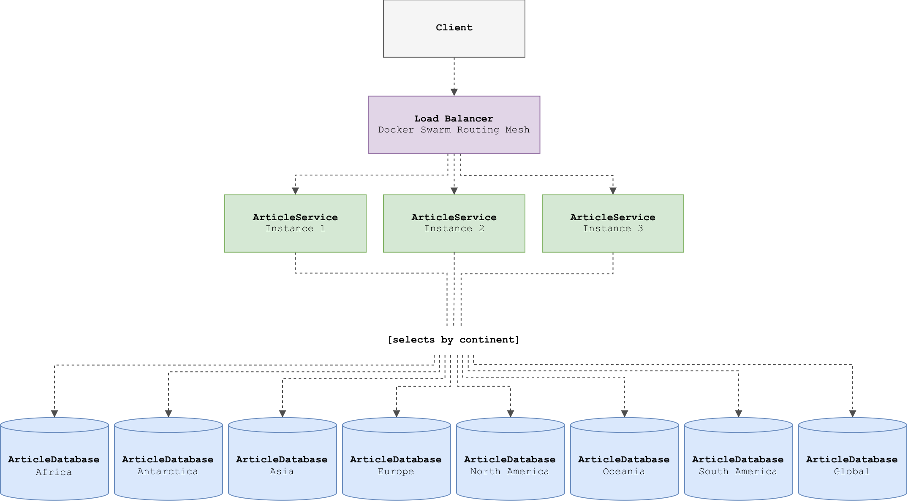
</picture>
<br><br>

The `ArticleService` is horizontally scaled across three instances using Docker Swarm. Incoming requests are distributed between the available instances.  

The `ArticleDatabase` is split by continent, with one database for each continent and an additional global database for articles relevant worldwide.  

Each `ArticleService` instance can access all eight databases and routes database operations according to the continent specified by the request.

#### ArticleService
Manages published articles and subscribes to publication events.

##### API Endpoints
| Method | Endpoint | Description | Request Body | Responses |
|---|---|---|---|---|
| `POST` | `/Articles/{continent}` | Create a published article in the specified continent database | `CreateArticleRequest` | 201, 400 |
| `GET` | `/Articles/{continent}/{id}` | Retrieve a published article | — | 200, 400, 404 |
| `GET` | `/Articles/{continent}` | Retrieve an article by publication date | — | 200, 400, 404 |
| `PATCH` | `/Articles/{continent}/{id}` | Update a published article | `UpdateArticleRequest` | 204, 400, 404 |
| `DELETE` | `/Articles/{continent}/{id}` | Delete a published article | — | 204, 400, 404 |

##### Path Parameters
| Parameter | Type | Required | Description |
|---|---|---|---|
| `continent` | `Continent` | Yes | Continent identifying the article database |
| `id` | GUID | Yes | Public article identifier |

Valid `continent` values:
- `Africa`
- `Antarctica`
- `Asia`
- `Europe`
- `NorthAmerica`
- `Oceania`
- `SouthAmerica`
- `Global`

##### Query Parameters
| Parameter | Type | Required | Description |
|---|---|---|---|
| `publicationDate` | DateOnly | Yes | Publication date in `YYYY-MM-DD` format |

The `publicationDate` parameter is used by `GET /Articles/{continent}`.

##### Request Bodies

###### CreateArticleRequest
Used by `POST /Articles/{continent}`.

| Property | Type | Required | Description |
|---|---|---|---|
| `author` | string | Yes | Article author (max. 100 characters) |
| `title` | string | Yes | Article title (max. 200 characters) |
| `content` | string | Yes | Article content |

Example:
```json
{
  "author": "Jane Doe",
  "title": "Example Article",
  "content": "Example article content."
}
```

###### UpdateArticleRequest
Used by `PATCH /Articles/{continent}/{id}`.

| Property | Type | Required | Description |
|---|---|---|---|
| `author` | string | No | Updated article author (max. 100 characters) |
| `title` | string | No | Updated article title (max. 200 characters) |
| `content` | string | No | Updated article content |

Example:
```json
{
  "title": "Updated Article Title"
}
```

Provided fields cannot be empty or contain only whitespace. Omitted or `null` fields are not updated.

##### HTTP Responses
| Status | Description |
|---|---|
| 200 OK | Article retrieved successfully |
| 201 Created | Article created successfully |
| 204 No Content | Article updated or deleted successfully |
| 400 Bad Request | Request validation or parameter binding failed |
| 404 Not Found | Requested article does not exist |

##### Response Bodies

###### ArticleResponse
Returned by:
- `POST /Articles/{continent}`
- `GET /Articles/{continent}/{id}`
- `GET /Articles/{continent}`

| Property | Type | Nullable | Description |
|---|---|---|---|
| `id` | GUID | No | Public article identifier |
| `author` | string | No | Article author |
| `title` | string | No | Article title |
| `content` | string | No | Article content |
| `publicationTimestampUtc` | DateTime | No | Article publication timestamp in UTC |
| `lastUpdatedTimestampUtc` | DateTime | Yes | Timestamp of the last article update in UTC |

##### Internal Flows
<picture>
  <source media="(prefers-color-scheme: dark)" srcset="./docs/figures/article-service-flow-dark.png">
  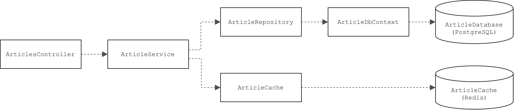
</picture>

<picture>
  <source media="(prefers-color-scheme: dark)" srcset="./docs/figures/article-service-flow-rabbitmq-dark.png">
  
</picture>

### ArticleDatabase
Stores published articles. Contains `articles` table.

<picture>
  <source media="(prefers-color-scheme: dark)" srcset="./docs/figures/article-database-dark.png">
  
</picture>

### Comment Management
Management, storage, and profanity filtering of comments.

<picture>
  <source media="(prefers-color-scheme: dark)" srcset="./docs/figures/comment-management-container-view-dark.png">
  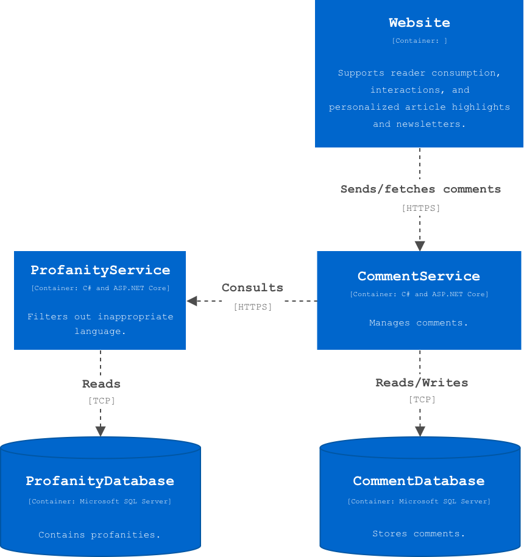
</picture>

##### Fault Isolation between Services
Within this scope, fault isolation is supported by:
- Each service owns its own database.
- A circuit breaker limits the impact of ProfanityService failures on CommentService.
- Operations that don't require profanity filtering can continue independently.

However, the implementation does not fully satisfy strict swimlane principles, as successful comment creation and content updates depend on a response from ProfanityService.

#### ProfanityService
Filters profanity from content.

##### API Endpoints
| Method | Endpoint | Description | Request Body | Responses |
|---|---|---|---|---|
| `POST` | `/Profanities/filter` | Filter profanity from content | `FilterContentRequest` | 200, 400 |

##### Request Bodies

###### FilterContentRequest
Used by `POST /Profanities/filter`.

| Property | Type | Required | Description |
|---|---|---|---|
| `content` | string | Yes | Content to filter for profanity |

Example:
```json
{
  "content": "Example content to filter."
}
```

##### HTTP Responses
| Status | Description |
|---|---|
| 200 OK | Content filtered successfully |
| 400 Bad Request | Request validation failed |

##### Response Bodies

###### FilterContentResponse
Returned by `POST /Profanities/filter`.

| Property | Type | Nullable | Description |
|---|---|---|---|
| `content` | string | No | Content with profanity filtered |

Example:
```json
{
  "content": "Filtered content."
}
```

##### Internal Flow
<picture>
  <source media="(prefers-color-scheme: dark)" srcset="./docs/figures/profanity-service-flow-dark.png">
  
</picture>

#### ProfanityDatabase
Contains `profanities` table.

<picture>
  <source media="(prefers-color-scheme: dark)" srcset="./docs/figures/profanity-database-dark.png">
  
</picture>

> Note: `term` also has a unique index on `lower(term)`, enforcing case-insensitive uniqueness.

#### CommentService
Manages comments.

##### API Endpoints
| Method | Endpoint | Description | Request Body | Responses |
|---|---|---|---|---|
| `POST` | `/Comments/{articleId}` | Create a comment for an article | `CreateCommentRequest` | 201, 400 |
| `GET` | `/Comments/article/{articleId}` | Retrieve all comments for an article | — | 200, 400 |
| `GET` | `/Comments/{id}` | Retrieve a comment by ID | — | 200, 400, 404 |
| `PATCH` | `/Comments/{id}` | Update a comment | `UpdateCommentRequest` | 204, 400, 404 |
| `DELETE` | `/Comments/{id}` | Delete a comment | — | 204, 400, 404 |

##### Path Parameters
| Parameter | Type | Required | Description |
|---|---|---|---|
| `articleId` | GUID | Yes | Public identifier of the article |
| `id` | GUID | Yes | Public identifier of the comment |

All path parameters are required.

##### Request Bodies

###### CreateCommentRequest
Used by `POST /Comments/{articleId}`.

| Property | Type | Required | Description |
|---|---|---|---|
| `author` | string | Yes | Comment author (max. 100 characters) |
| `content` | string | Yes | Comment content (max. 2000 characters) |

Example:
```json
{
  "author": "Jane Doe",
  "content": "Example comment content."
}
```

###### UpdateCommentRequest
Used by `PATCH /Comments/{id}`.

| Property | Type | Required | Description |
|---|---|---|---|
| `content` | string | No | Updated comment content (max. 2000 characters) |

Example:
```json
{
  "content": "Updated comment content."
}
```

The `content` field cannot be empty or contain only whitespace when provided with a non-null value.

##### HTTP Responses
| Status | Description |
|---|---|
| 200 OK | Comment or comments retrieved successfully |
| 201 Created | Comment created successfully |
| 204 No Content | Comment updated or deleted successfully |
| 400 Bad Request | Request validation or parameter binding failed |
| 404 Not Found | Requested comment does not exist |

##### Response Bodies

###### CommentResponse
Returned by:
- `POST /Comments/{articleId}`
- `GET /Comments/article/{articleId}`
- `GET /Comments/{id}`

| Property | Type | Nullable | Description |
|---|---|---|---|
| `id` | GUID | No | Public comment identifier |
| `articleId` | GUID | No | Public identifier of the associated article |
| `author` | string | No | Comment author |
| `content` | string | No | Comment content |
| `creationTimestampUtc` | DateTime | No | Comment creation timestamp in UTC |
| `lastUpdatedTimestampUtc` | DateTime | Yes | Timestamp of the last comment update in UTC |

`GET /Comments/article/{articleId}` returns a collection of `CommentResponse` objects.

##### Internal Flow
<picture>
  <source media="(prefers-color-scheme: dark)" srcset="./docs/figures/comment-service-flow-dark.png">
  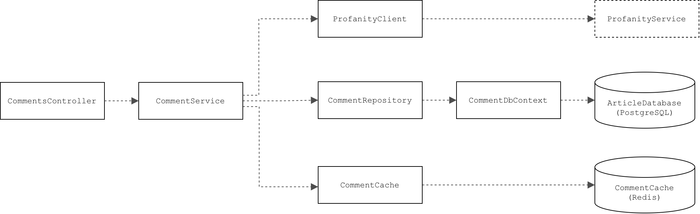
</picture>

##### Circuit Breaker Pattern
- Implemented with Polly to handle failures when communicating with ProfanityService.
- Monitors requests over a 10-second period and opens when at least 3 requests have been made and 50% or more have failed
- Prevents further requests to ProfanityService for 30 seconds while the circuit is open.
- Allows a test request after 30 seconds to determine whether ProfanityService has recovered.
- If ProfanityService remains unavailable, comment creation and content updates fail, while comment retrieval and deletion remain available.

##### CommentDatabase
Stores profanity-filtered comments. Contains `comments` table.

<picture>
  <source media="(prefers-color-scheme: dark)" srcset="./docs/figures/comment-database-dark.png">
  
</picture>

### Monitoring
Shared library that provides reusable logging and tracing functionality across services using Serilog and OpenTelemetry.  
Service names identify the source of traces.  

### Draft Management
Management and storage of drafts.

<picture>
  <source media="(prefers-color-scheme: dark)" srcset="./docs/figures/draft-management-container-view-dark.png">
  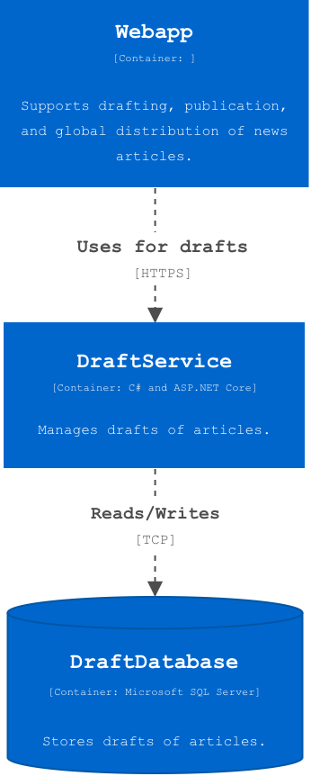
</picture>

##### Monitoring Plan
Focus on logging significant events and tracing application operations to support troubleshooting without generating unnecessary logs. Collection of logs and traces centrally to simplify troubleshooting.

<b>Logging:</b>
- Use information logs for successful operations that modify data to provide a record of changes.
- Use warning logs for unsuccessful update and delete operations to highlight potentially unexpected or problematic behaviour.
- Use debug logs for less significant events, such as retrieval of nonexisting drafts.
- Avoid logging method invocation as tracing will provide visibility into operation execution.

<b>Tracing:</b>
- Trace all CRUD operations to identify execution times and potential performance issues.
- Trace incoming HTTP requests and support tracing outgoing HTTP calls to provide visibility across service boundaries.

#### DraftService
Manages drafts.

##### API Endpoints
| Method | Endpoint | Description | Request Body | Responses |
|---|---|---|---|---|
| `POST` | `/Drafts` | Create a new draft | `DraftRequest` | 201, 400 |
| `GET` | `/Drafts/{id}` | Retrieve a draft by ID | — | 200, 400, 404 |
| `PUT` | `/Drafts/{id}` | Update a draft | `DraftRequest` | 204, 400, 404 |
| `DELETE` | `/Drafts/{id}` | Delete a draft | — | 204, 400, 404 |

##### Path Parameters
| Parameter | Type | Required | Description |
|---|---|---|---|
| `id` | GUID | Yes | Public identifier of the draft |

##### Request Bodies

###### DraftRequest
Used by:
- `POST /Drafts`
- `PUT /Drafts/{id}`

| Property | Type | Required | Description |
|---|---|---|---|
| `author` | string | No | Draft author (max. 100 characters) |
| `title` | string | No | Draft title (max. 200 characters) |
| `content` | string | No | Draft content |

All properties are optional and nullable.

Example:
```json
{
  "author": "Jane Doe",
  "title": "Example Draft",
  "content": "Example draft content."
}
```

##### HTTP Responses
| Status | Description |
|---|---|
| 200 OK | Draft retrieved successfully |
| 201 Created | Draft created successfully |
| 204 No Content | Draft updated or deleted successfully |
| 400 Bad Request | Request validation or parameter binding failed |
| 404 Not Found | Requested draft does not exist |

##### Response Bodies

###### DraftResponse
Returned by:
- `POST /Drafts`
- `GET /Drafts/{id}`

| Property | Type | Nullable | Description |
|---|---|---|---|
| `id` | GUID | No | Public draft identifier |
| `author` | string | Yes | Draft author |
| `title` | string | Yes | Draft title |
| `content` | string | Yes | Draft content |
| `creationTimestampUtc` | DateTime | No | Draft creation timestamp in UTC |
| `lastUpdatedTimestampUtc` | DateTime | Yes | Timestamp of the last draft update in UTC |

##### Internal Flow
<picture>
  <source media="(prefers-color-scheme: dark)" srcset="./docs/figures/draft-service-flow-dark.png">
  
</picture>

##### Monitoring Implementation
<b>Logging:</b>
- Structured logging using Serilog with logs collected centrally in Seq.
- Information logs for successful creation, update, and deletion of drafts.
- Warning logs for unsuccessful attempts to update or delete drafts that do not exist.
- Debug logs when attempting to retrieve a draft that does not exist.

<picture>
  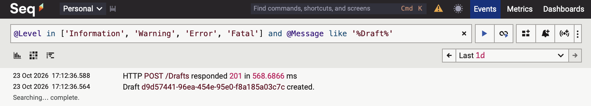
</picture>

<b>Tracing:</b>
- Tracing using OpenTelemetry, with traces collected centrally in Aspire Dashboard.
- Traces the execution of DraftService's CRUD operations, including their duration.
- Automatic instrumentation captures incoming HTTP requests and supports tracing of outgoing HTTP calls.

<picture>
  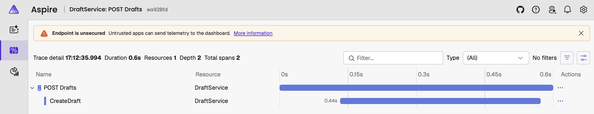
</picture>

##### DraftDatabase
Stores drafts. Contains `drafts` table.

<picture>
  <source media="(prefers-color-scheme: dark)" srcset="./docs/figures/draft-database-dark.png">
  
</picture>

### Messaging
Shared library. Uses RabbitMQ to provide reusable functionality for asynchronous communication between services, including event publishing, consumption, and distributed tracing.

### Publication
Publication, distribution, storage, and newsletter retrieval of published articles.

<picture>
  <source media="(prefers-color-scheme: dark)" srcset="./docs/figures/publication-container-view-dark.png">
  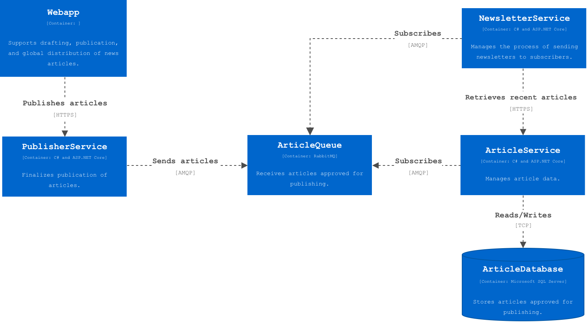
</picture>

##### Distributed Tracing Plan
- Trace significant application operations related to publication and newsletter retrieval to identify execution times and potential performance issues in this scope.
- Trace incoming HTTP requests and outgoing HTTP calls to provide visibility across service boundaries.
- Trace RabbitMQ message publishing and consumption to track asynchronous communication between services.
- Propagate trace context across HTTP and RabbitMQ communication to maintain connected distributed traces.

##### Distributed Tracing Implementation
- Tracing using OpenTelemetry with traces collected centrally in Aspire Dashboard.
- Traces significant application operations related to publication and newsletter retrieval in PublisherService, ArticleService, and NewsletterService, including their duration.
- Automatic instrumentation captures incoming HTTP requests and outgoing HTTP calls.
- Traces RabbitMQ message publishing and consumption using producer and consumer spans.
- Trace context propagation through RabbitMQ message headers maintains connected traces across asynchronous service boundaries.

<picture>
  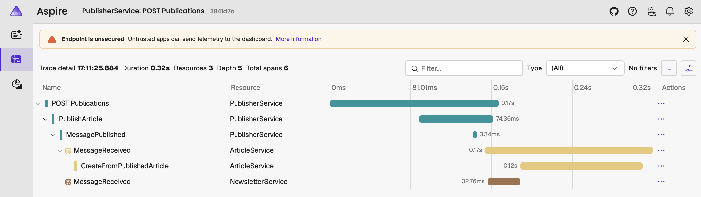
</picture>

<br>

<picture>
  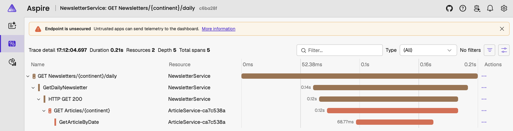
</picture>

<br>

<picture>
  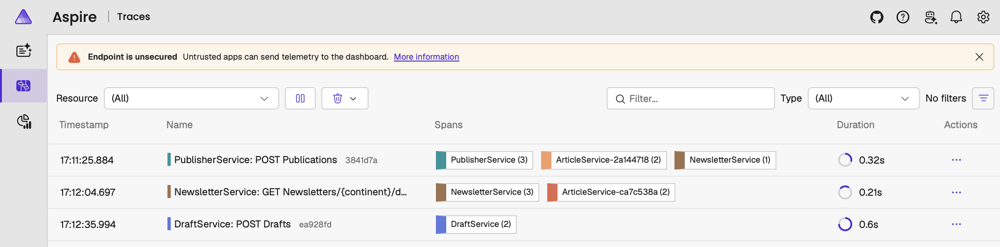
</picture>

#### PublisherService
Publishes articles to queue.

##### API Endpoints
| Method | Endpoint | Description | Request Body | Responses |
|---|---|---|---|---|
| `POST` | `/Publications` | Publish an article through the messaging system | `CreatePublicationRequest` | 202, 400 |

##### Request Bodies

###### CreatePublicationRequest
Used by `POST /Publications`.

| Property | Type | Required | Description |
|---|---|---|---|
| `author` | string | Yes | Article author |
| `title` | string | Yes | Article title |
| `content` | string | Yes | Article content |
| `continent` | `Continent` | Yes | Continent in which the article should be published |

Valid `continent` values:
- `Africa`
- `Antarctica`
- `Asia`
- `Europe`
- `NorthAmerica`
- `Oceania`
- `SouthAmerica`
- `Global`

Example:
```json
{
  "author": "Jane Doe",
  "title": "Example Article",
  "content": "Example article content.",
  "continent": "Europe"
}
```

##### HTTP Responses
| Status | Description |
|---|---|
| 202 Accepted | Publication request accepted for processing |
| 400 Bad Request | Request validation failed |

The `202 Accepted` response indicates that the publication request was accepted, but does not guarantee that the article has been persisted by ArticleService.

##### Internal Flow
<picture>
  <source media="(prefers-color-scheme: dark)" srcset="./docs/figures/publisher-service-flow-dark.png">
  
</picture>

#### NewsletterService
Subscribes to published article events and retrieves articles for daily newsletters.

##### API Endpoints
| Method | Endpoint | Description | Request Body | Responses |
|---|---|---|---|---|
| `GET` | `/Newsletters/{continent}/daily` | Retrieve the daily newsletter for a continent and date | — | 200, 204, 400 |

##### Path Parameters
| Parameter | Type | Required | Description |
|---|---|---|---|
| `continent` | `Continent` | Yes | Continent for which to retrieve the newsletter |

Valid `continent` values:
- `Africa`
- `Antarctica`
- `Asia`
- `Europe`
- `NorthAmerica`
- `Oceania`
- `SouthAmerica`
- `Global`

##### Query Parameters
| Parameter | Type | Required | Description |
|---|---|---|---|
| `date` | DateOnly | Yes | Newsletter date in `YYYY-MM-DD` format |

Example:
```http
GET /Newsletters/Europe/daily?date=2026-11-04
```

##### HTTP Responses
| Status | Description |
|---|---|
| 200 OK | Daily newsletter retrieved successfully |
| 204 No Content | No newsletter exists for the specified continent and date |
| 400 Bad Request | Parameter binding failed |

##### Response Bodies

###### NewsletterResponse
Returned by `GET /Newsletters/{continent}/daily` when a newsletter exists.

| Property | Type | Nullable | Description |
|---|---|---|---|
| `date` | DateOnly | No | Newsletter date |
| `article` | `ArticleResponse` | No | Article included in the newsletter |

###### ArticleResponse
Nested within `NewsletterResponse`.

| Property | Type | Nullable | Description |
|---|---|---|---|
| `id` | GUID | No | Public article identifier |
| `author` | string | No | Article author |
| `title` | string | No | Article title |
| `content` | string | No | Article content |
| `publicationTimestampUtc` | DateTime | No | Article publication timestamp in UTC |

Example:
```json
{
  "date": "2026-11-04",
  "article": {
    "id": "550e8400-e29b-41d4-a716-446655440000",
    "author": "Jane Doe",
    "title": "Example Article",
    "content": "Example article content.",
    "publicationTimestampUtc": "2026-11-04T10:30:00Z"
  }
}
```

##### Internal Flows
<picture>
  <source media="(prefers-color-scheme: dark)" srcset="./docs/figures/newsletter-service-flow-dark.png">
  
</picture>

<picture>
  <source media="(prefers-color-scheme: dark)" srcset="./docs/figures/newsletter-service-flow-rabbitmq-dark.png">
  
</picture>

#### ArticleQueue
Handles asynchronous communication between PublisherService, ArticleService, and NewsletterService using RabbitMQ.

PublisherService publishes `ArticlePublished` events to the `article.published` fanout exchange, which distributes the events to separate queues for ArticleService and NewsletterService.

| Exchange | Type | Consumer | Queue |
|---|---|---|---|
| `article.published` | Fanout | ArticleService | `article.article-published` |
| `article.published` | Fanout | NewsletterService | `newsletter.article-published` |

The `ArticlePublished` event contains:
```json
{
  "articleId": "guid",
  "author": "string",
  "title": "string",
  "content": "string",
  "publicationTimestampUtc": "datetime",
  "continent": "string"
}
```

### Caching
<picture>
  <source media="(prefers-color-scheme: dark)" srcset="./docs/figures/cache-container-view-dark.png">
  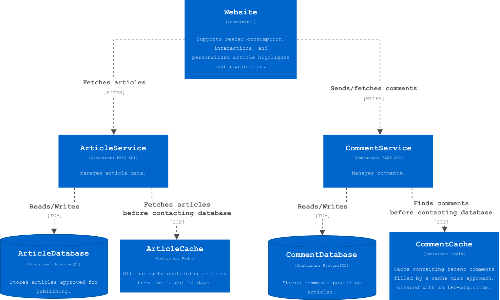
</picture>
<br><br><br>

Prometheus is used to collect and store cache metrics. Grafana queries Prometheus to visualize the metrics in a dashboard.<br><br>
<picture>
  <source media="(prefers-color-scheme: dark)" srcset="./docs/figures/cache-metrics-dark.png">
  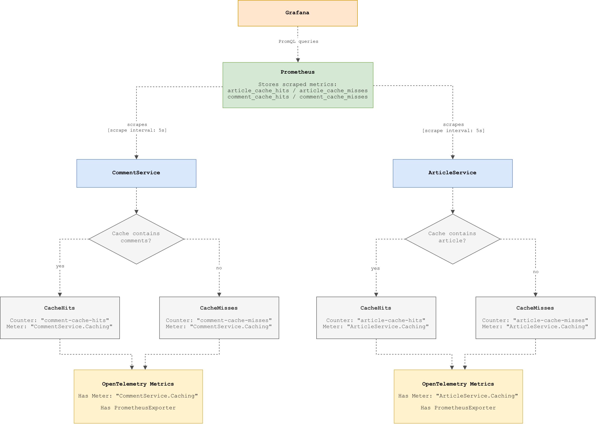
</picture>
<br><br>

A Grafana dashboard displays cache hits, misses, and hit ratios for both caches, including a comparison of their hit ratios over time.<br><br>
<picture>
  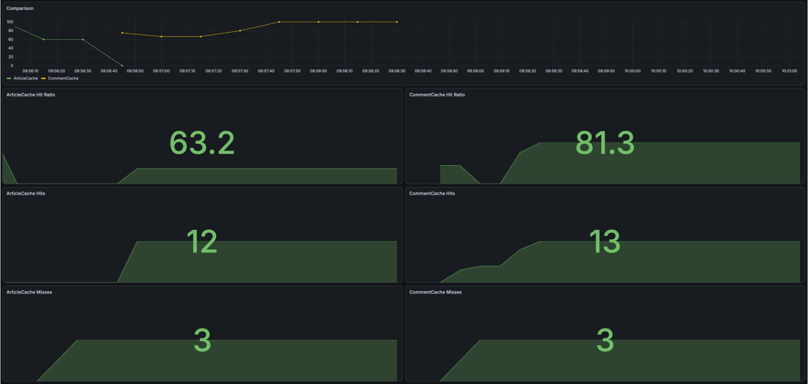
</picture>

#### ArticleCache
Periodic offline caching. The cache stores global articles published within the last 14 days. Articles older than 14 days are removed from the cache.

##### High-Level Overview of Cache Refresh
<picture>
  <source media="(prefers-color-scheme: dark)" srcset="./docs/figures/article-cache-refresh-dark.png">
  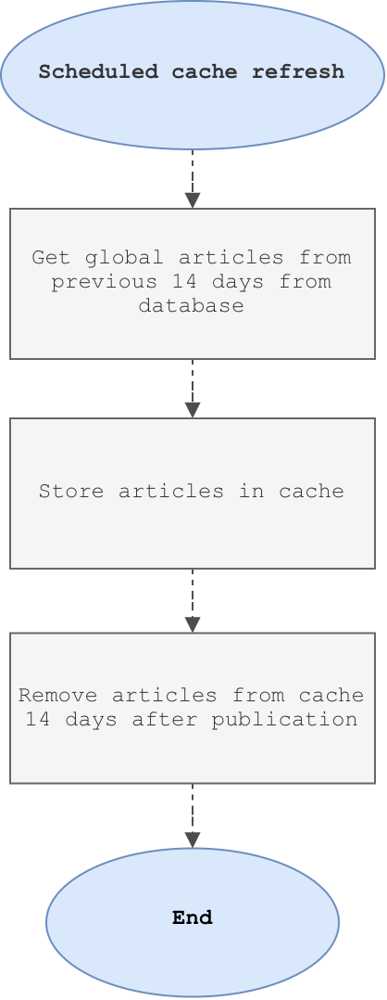
</picture>

##### High-Level Overview of Cache Retrieval
<picture>
  <source media="(prefers-color-scheme: dark)" srcset="./docs/figures/article-cache-retrieval-dark.png">
  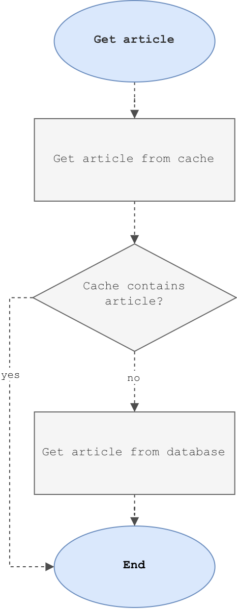
</picture>

##### Offline Caching
<picture>
  <source media="(prefers-color-scheme: dark)" srcset="./docs/figures/articles-offline-caching-dark.png">
  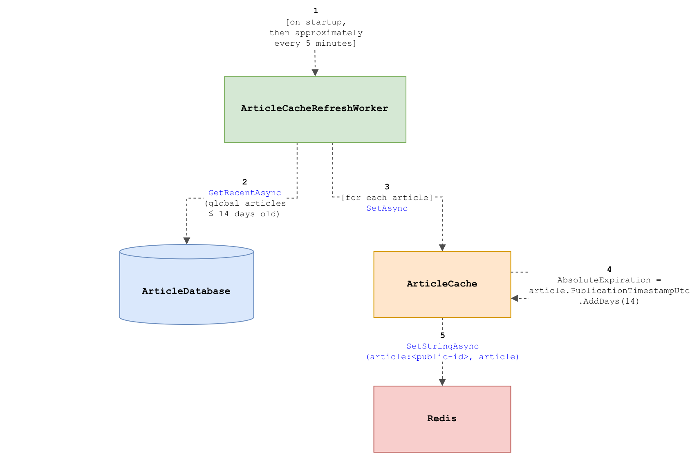
</picture>

##### Retrieval of Articles
<picture>
  <source media="(prefers-color-scheme: dark)" srcset="./docs/figures/article-cache-retrieval-low-level-dark.png">
  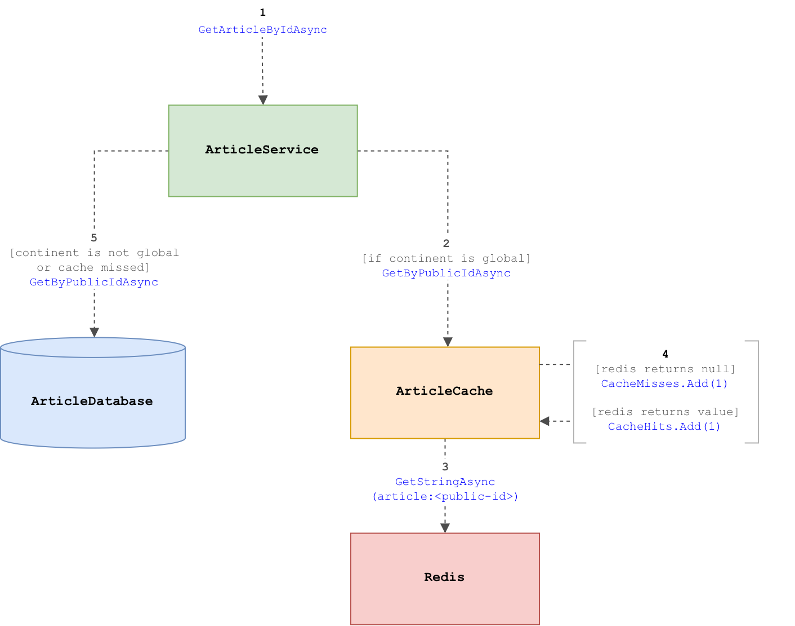
</picture>

#### CommentCache
Cache-on-miss approach. The cache stores comments for up to 30 recently accessed articles. An LRU (Least Recently Used) algorithm is used to evict the least recently accessed entries when the cache reaches its capacity.

##### High-Level Overview of Cache Retrieval, Population, and Eviction
<picture>
  <source media="(prefers-color-scheme: dark)" srcset="./docs/figures/comment-cache-retrieval-dark.png">
  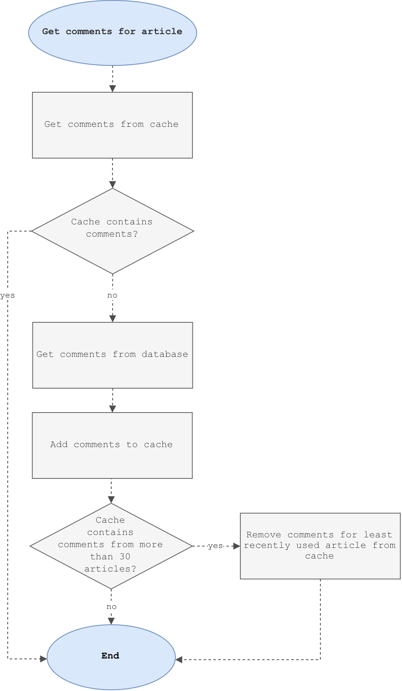
</picture>

##### High-Level Overview of Cache Invalidation
<picture>
  <source media="(prefers-color-scheme: dark)" srcset="./docs/figures/comment-cache-invalidation-dark.png">
  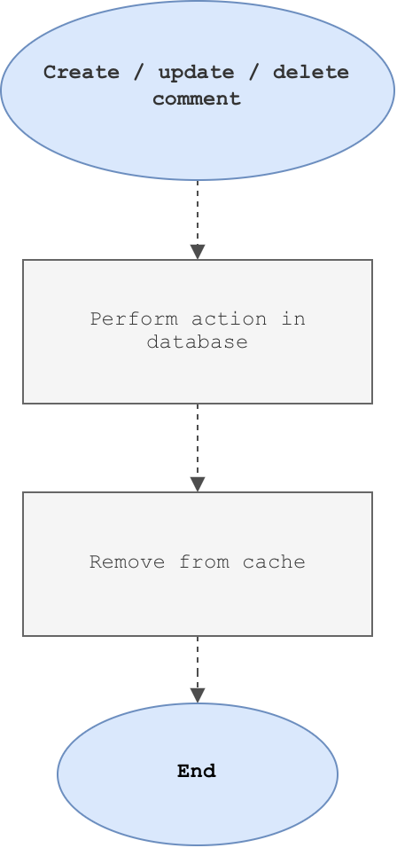
</picture>

##### Retrieval of Comments: Cache Hit
<picture>
  <source media="(prefers-color-scheme: dark)" srcset="./docs/figures/comment-cache-hit-dark.png">
  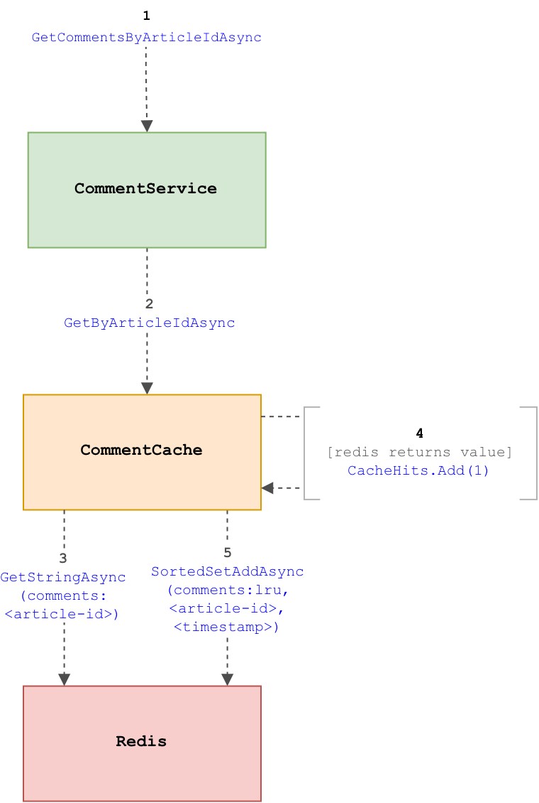
</picture>

##### Retrieval of Comments: Cache Miss
> Note: Step 1 of this diagram takes place after the first three steps of the Cache Hit diagram.

<picture>
  <source media="(prefers-color-scheme: dark)" srcset="./docs/figures/comment-cache-miss-dark.png">
  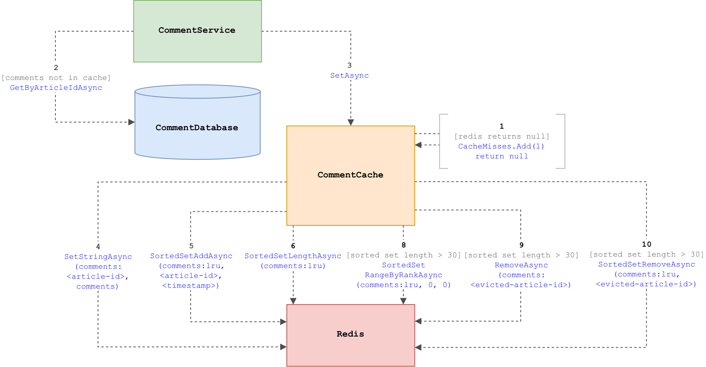
</picture>

##### Cache Invalidation
> Note: In this diagram, `<operation>` represents either `Get`, `Update`, or `Delete`.

<picture>
  <source media="(prefers-color-scheme: dark)" srcset="./docs/figures/comment-cache-invalidation-low-level-dark.png">
  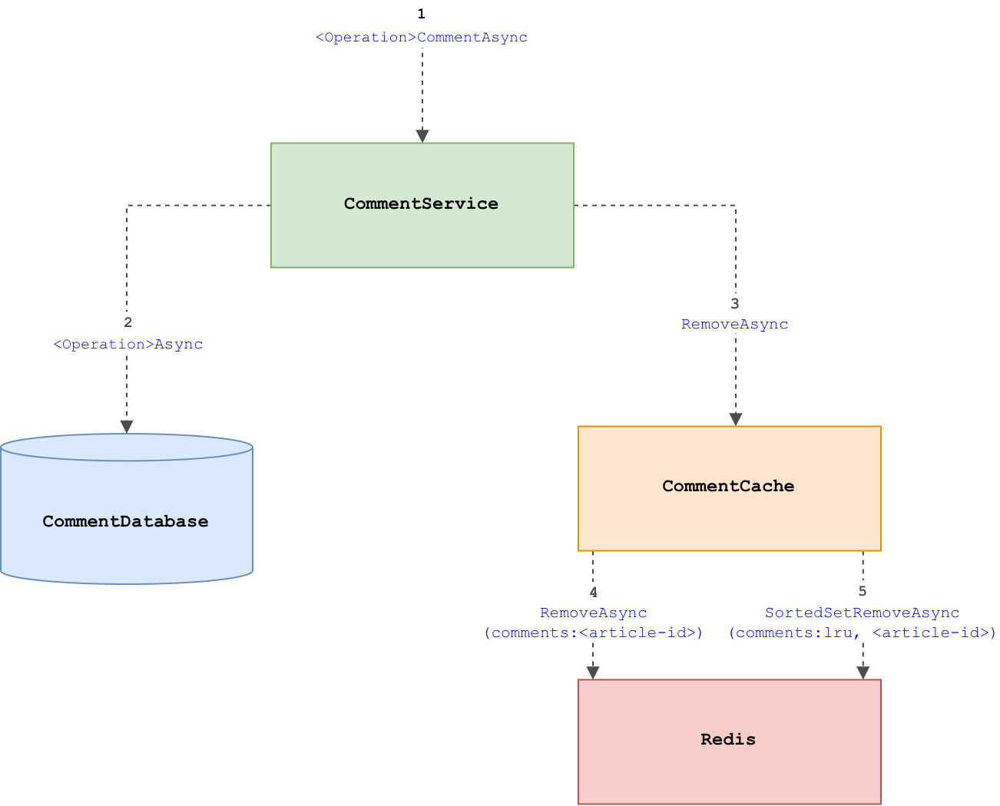
</picture>

### Subscription Management
Management and storage of newsletter subscribers, including asynchronous notification of new subscriptions.

<picture>
  <source media="(prefers-color-scheme: dark)" srcset="./docs/figures/subscription-management-container-view-dark.png">
  
</picture>

##### Fault Isolation and Release Toggle
SubscriberService operates independently of NewsletterService and maintains its own database. Communication between the services uses HTTP for subscriber retrieval and RabbitMQ for asynchronous notification of new subscriptions.

FeatureHub controls SubscriberService availability through a release toggle. Disabling SubscriberService does not require restarting or redeploying the system. NewsletterService handles failed subscriber retrieval requests without affecting unrelated operations.

#### SubscriberService
Manages newsletter subscriptions and publishes events when new subscribers are created.

##### API Endpoints
| Method | Endpoint | Description | Request Body | Responses |
|---|---|---|---|---|
| `POST` | `/Subscribers` | Create a new subscriber | `CreateSubscriberRequest` | 201, 400, 409, 500 |
| `GET` | `/Subscribers` | Retrieve all subscribers | — | 200 |
| `DELETE` | `/Subscribers/{id}` | Delete a subscriber by public ID | — | 204, 400, 404 |

##### Path Parameters
| Parameter | Type | Required | Description |
|---|---|---|---|
| `id` | GUID | Yes | Public identifier of the subscriber |

##### Request Bodies

###### CreateSubscriberRequest
Used by `POST /Subscribers`.

| Property | Type | Required | Description |
|---|---|---|---|
| `email` | string | Yes | Subscriber email address (max. 255 characters) |

Example:
```json
{
  "email": "jane@example.com"
}
```

##### HTTP Responses
| Status | Description |
|---|---|
| 200 OK | Subscribers retrieved successfully |
| 201 Created | Subscriber created successfully |
| 204 No Content | Subscriber deleted successfully |
| 400 Bad Request | Request validation or parameter binding failed |
| 404 Not Found | Requested subscriber does not exist |
| 409 Conflict | A subscriber with the specified email already exists |
| 500 Internal Server Error | An unexpected result occurred during subscriber creation |

##### Response Bodies

###### SubscriberResponse
Returned by:
- `POST /Subscribers`
- `GET /Subscribers`

| Property | Type | Nullable | Description |
|---|---|---|---|
| `id` | GUID | No | Public subscriber identifier |
| `email` | string | No | Subscriber email address |
| `subscriptionTimestampUtc` | DateTime | No | Subscription creation timestamp in UTC |

`GET /Subscribers` returns a collection of `SubscriberResponse` objects.

Example:
```json
{
  "id": "550e8400-e29b-41d4-a716-446655440000",
  "email": "jane@example.com",
  "subscriptionTimestampUtc": "2026-11-04T10:30:00Z"
}
```

A `409 Conflict` response contains the message:
```text
A subscriber with this email already exists.
```

#### SubscriberDatabase
Stores subscribers. Contains `subscribers` table.

<picture>
  <source media="(prefers-color-scheme: dark)" srcset="./docs/figures/subscriber-database-dark.png">
  
</picture>

#### SubscriberQueue
Handles asynchronous communication between SubscriberService and NewsletterService using RabbitMQ.

SubscriberService publishes `SubscriberCreated` events to the `subscriber.created` fanout exchange, which distributes the events to NewsletterService's queue for processing welcome emails.

| Exchange | Type | Consumer | Queue |
|---|---|---|---|
| `subscriber.created` | Fanout | NewsletterService | `newsletter.subscriber-created` |

The `SubscriberCreated` event contains:

```json
{
  "email": "string"
}
```

#### NewsletterService
Extended to retrieve subscribers from SubscriberService through HTTP and consume `SubscriberCreated` events through RabbitMQ.

##### API Endpoints
| Method | Endpoint | Description | Request Body | Responses |
|---|---|---|---|---|
| `GET` | `/Newsletters/subscribers` | Retrieve subscribers from SubscriberService | — | 200, 503 |

##### HTTP Responses
| Status | Description |
|---|---|
| 200 OK | Subscribers retrieved successfully |
| 503 Service Unavailable | SubscriberService is unavailable |

##### Response Bodies

###### SubscriberResponse
Returned by `GET /Newsletters/subscribers`.

| Property | Type | Nullable | Description |
|---|---|---|---|
| `email` | string | No | Subscriber email address |

The endpoint returns a collection of `SubscriberResponse` objects.

Example:
```json
[
  {
    "email": "jane@example.com"
  },
  {
    "email": "john@example.com"
  }
]
```

A `503 Service Unavailable` response contains the message:
```text
SubscriberService is unavailable.
```

##### Welcome Emails
NewsletterService consumes `SubscriberCreated` events and simulates sending welcome emails through logging.

## CI/CD Pipeline
The CI/CD pipelines follow the same workflow to automatically build and publish versioned Docker images to GitHub Container Registry.

<picture>
  <source media="(prefers-color-scheme: dark)" srcset="./docs/figures/ci-cd-dark.png">
  <source media="(prefers-color-scheme: light)" srcset="./docs/figures/ci-cd-light.png">
  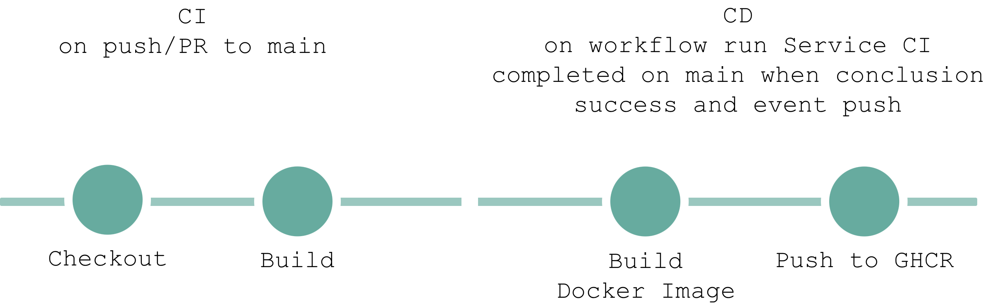
</picture>

CI/CD pipelines exist for:
- ArticleService
- CommentService
- DraftService
- NewsletterService
- ProfanityService
- PublisherService
- SubscriberService

## Running the System with Docker Swarm
> Run the following commands from the project root

### Configuration
> Configure the SubscriberServiceEnabled release toggle in FeatureHub and use its SDK key to connect SubscriberService.

```bash
export FEATUREHUB_SDK_KEY="<featurehub-sdk-key>"
```

### Build Service Images
```bash
docker build -t article-service:latest -f ArticleService/Dockerfile .
docker build -t comment-service:latest -f CommentService/Dockerfile .
docker build -t draft-service:latest -f DraftService/Dockerfile .
docker build -t newsletter-service:latest -f NewsletterService/Dockerfile .
docker build -t profanity-service:latest -f ProfanityService/Dockerfile .
docker build -t publisher-service:latest -f PublisherService/Dockerfile .
docker build -t subscriber-service:latest -f SubscriberService/Dockerfile .
```

### Initialize Docker Swarm
```bash
docker swarm init
```

### Deploy Compose File as a Swarm Stack
```bash
docker stack deploy -c docker-compose.yml happy-headlines
```

## Inspecting and Verifying the Project
### View Nodes
```bash
docker node ls
```

### View Services
```bash
docker stack services happy-headlines
```

### View Containers
```bash
docker ps
```

### View Service Replicas
```bash
docker service ps happy-headlines_<service>
```

### Verify Tables
```bash
docker exec -it <container-id> psql -U happy-headlines -d <database> -c "\dt"
```

### Verify Data
```bash
docker exec -it <container-id> psql -U happy-headlines -d <database> -c "SELECT * FROM <table>;"
```

### Access Infrastructure Dashboards
| Dashboard | Address |
|---|---|
| FeatureHub | `http://localhost:9000` |
| Seq | `http://localhost:80` |
| RabbitMQ Management | `http://localhost:15672` |
| Prometheus | `http://localhost:9090` |
| Grafana | `http://localhost:3000` |

#### Access Aspire Dashboard
```bash
docker service logs happy-headlines_aspire-dashboard 2>&1 | grep 'login?t='
```

## Stopping the Project
### Stop Stack
```bash
docker stack rm happy-headlines
```

### Delete Persistent Volumes
```bash
docker volume rm \
  happy-headlines_featurehub-h2-data \
  happy-headlines_seq-data \
  happy-headlines_rabbitmq-data \
  happy-headlines_subscriber-database-data \
  happy-headlines_draft-database-data \
  happy-headlines_profanity-database-data \
  happy-headlines_comment-database-data \
  happy-headlines_article-database-africa-data \
  happy-headlines_article-database-antarctica-data \
  happy-headlines_article-database-asia-data \
  happy-headlines_article-database-europe-data \
  happy-headlines_article-database-north-america-data \
  happy-headlines_article-database-oceania-data \
  happy-headlines_article-database-south-america-data \
  happy-headlines_article-database-global-data 
```

### Leave Docker Swarm
```bash
docker swarm leave --force
```